# TP5 – Activité 5-1 : Service de conversion de devise (Java RMI)

**Étudiant :** Nour Hbaieb
**Classe :** LSI3 1TP1
**Matière :** Développement d'Applications Réparties
**Enseignante des TPs :** Zeineb DAOUD
**Environnement :** IntelliJ IDEA, JDK, Git/GitHub

## 1. Objectif

Concevoir une application répartie avec Java RMI. Un serveur expose un service
de conversion de devises. Un client distant l'invoque pour convertir un montant
en euros vers le dinar tunisien.

## 2. Structure du dépôt

```
TP5-DAR2026/
├── RMIConversion_Server/
├── RMIConversion_Client/
├── conversionClient.jar
├── images/
└── README.md
```

## 3. Développement du serveur (projet `RMIConversion_Server`)

Le projet serveur contient deux packages :
- `rmiService` : l'interface distante `IConversion` et son implémentation `ConversionImpl`
- `rmiServer` : la classe `ConversionServer`, qui active le RMIRegistry, crée
  l'objet distant et publie sa référence dans l'annuaire


### Interface distante

```java
package rmiService;

import java.rmi.Remote;
import java.rmi.RemoteException;

public interface IConversion extends Remote {
    double convertirMontant(double mt) throws RemoteException;
}
```

### Implémentation

```java
package rmiService;

import java.rmi.RemoteException;
import java.rmi.server.UnicastRemoteObject;

public class ConversionImpl extends UnicastRemoteObject implements IConversion {
    private static final double TAUX_EUR_TND = 3.40;

    public ConversionImpl() throws RemoteException {
        super();
    }

    @Override
    public double convertirMontant(double mt) throws RemoteException {
        return mt * TAUX_EUR_TND;
    }
}
```

### Serveur

```java
package rmiServer;

import java.rmi.Naming;
import java.rmi.registry.LocateRegistry;
import rmiService.ConversionImpl;

public class ConversionServer {
    public static void main(String[] args) {
        try {
            LocateRegistry.createRegistry(1099);                  // i. activer le RMIRegistry
            ConversionImpl service = new ConversionImpl();        // ii. créer l'objet distant
            Naming.rebind("rmi://localhost:1099/ConversionService", service); // iii. publier
            System.out.println("Serveur RMI démarré : ConversionService est publié.");
        } catch (Exception e) {
            e.printStackTrace();
        }
    }
}
```

## 4. Développement du client (projet `RMIConversion_Client`)

### Création du projet client

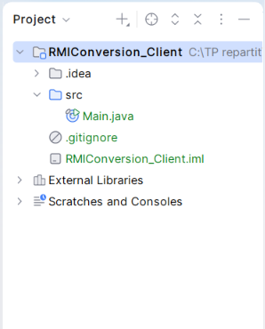

### Export de l'interface distante en `.jar`

Seule l'interface `IConversion` est exportée dans `conversionClient.jar`.
`ConversionImpl` n'est pas incluse, car l'implémentation reste côté serveur.
Le JAR est créé en ligne de commande puis vérifié avec `jar tf` :

```powershell
javac -d tmp_jar src\rmiService\IConversion.java
jar cf ..\conversionClient.jar -C tmp_jar rmiService\IConversion.class
jar tf ..\conversionClient.jar
```


Le fichier `conversionClient.jar` est enregistré dans l'espace de travail :


### Ajout du JAR au classpath du client

*File → Project Structure → Modules → Dependencies → + → JARs or Directories*.


Le JAR apparaît dans les bibliothèques externes du projet client, avec le
package `rmiService` et l'interface `IConversion` :


### Classe client

```java
package rmiClient;

import java.rmi.Naming;
import rmiService.IConversion;

public class ConversionClient {
    public static void main(String[] args) {
        try {
            IConversion service =
                (IConversion) Naming.lookup("rmi://localhost:1099/ConversionService");
            double resultat = service.convertirMontant(500);
            System.out.println("500 EUR = " + resultat + " TND");
        } catch (Exception e) {
            e.printStackTrace();
        }
    }
}
```

## 5. Exécution de l'application

Le serveur est lancé en premier. Sa console reste active, car il attend les
appels des clients.


Le client est ensuite exécuté. Il récupère la référence de l'objet distant dans
le RMIRegistry et invoque `convertirMontant(500)` :


**Résultat obtenu :** `500 EUR = 1700.0 TND` (taux fixe de 3,40).

## 6. Synthèse

Ce TP m'a permis de mettre en œuvre une communication client/serveur avec Java
RMI et de comprendre le cycle de vie d'un service distant :

1. **Définition de l'interface** : `IConversion` étend `Remote`, et sa méthode
   déclare `RemoteException`.
2. **Implémentation** : `ConversionImpl` étend `UnicastRemoteObject`, ce qui
   exporte automatiquement l'objet pour qu'il reçoive des appels distants.
3. **Enregistrement** : le serveur démarre le RMIRegistry avec
   `LocateRegistry.createRegistry(1099)` et publie l'objet avec `Naming.rebind`.
4. **Invocation** : le client retrouve l'objet avec `Naming.lookup` et appelle
   `convertirMontant` comme une méthode locale.

Le client ne dispose que de l'interface, via `conversionClient.jar`. Le code
métier reste sur le serveur, ce qui sépare clairement les deux applications.

**Difficultés rencontrées :** la génération du JAR a échoué avec le chemin
`out\production`. Je l'ai résolue en compilant l'interface seule avec `javac`
puis en créant le JAR avec la commande `jar`, adaptée à PowerShell.

---

# Activité 5-2 : Service de banque (RMI + JNDI)

## Objectif
Gérer des comptes bancaires (code, solde, date de création) via un serveur RMI
central. Le client peut créer un compte (si le code n'existe pas) et consulter
un compte à partir de son code. L'application est d'abord réalisée avec le
registre RMI, puis migrée vers JNDI.

## Étape 2 : Serveur `RMIBanque_Server`
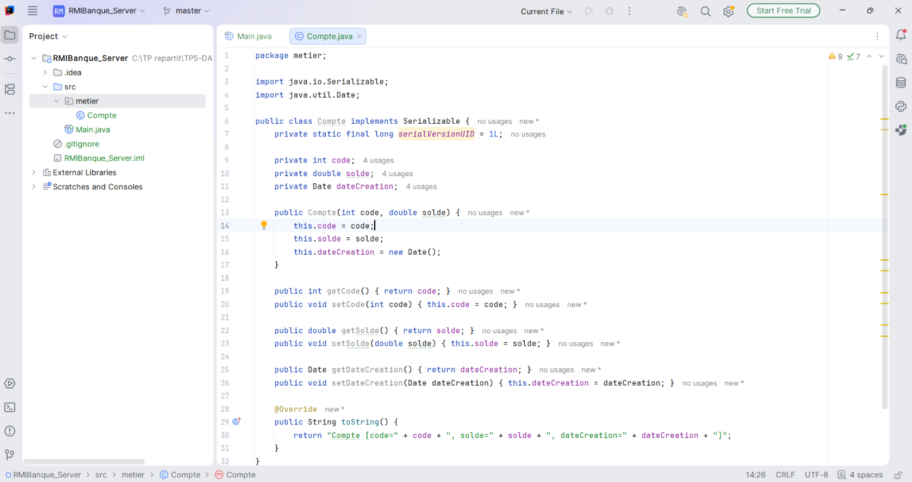

**Classe sérialisable `Compte`** (package `metier`)
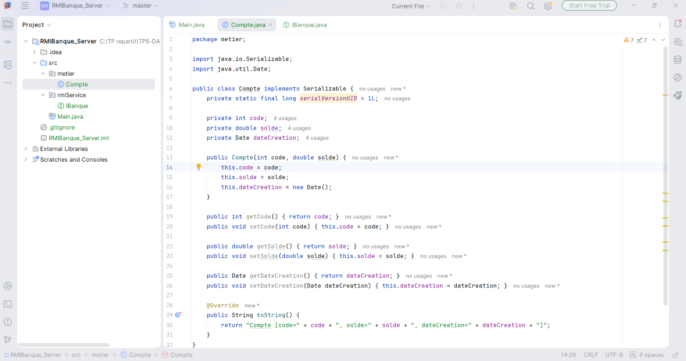

**Interface distante `IBanque`** (package `rmiService`)
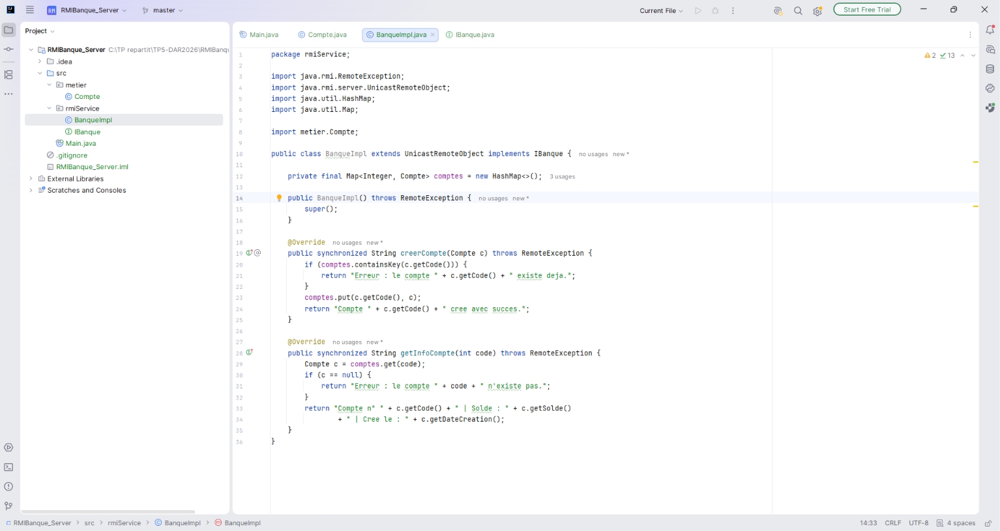

**Implémentation `BanqueImpl`**
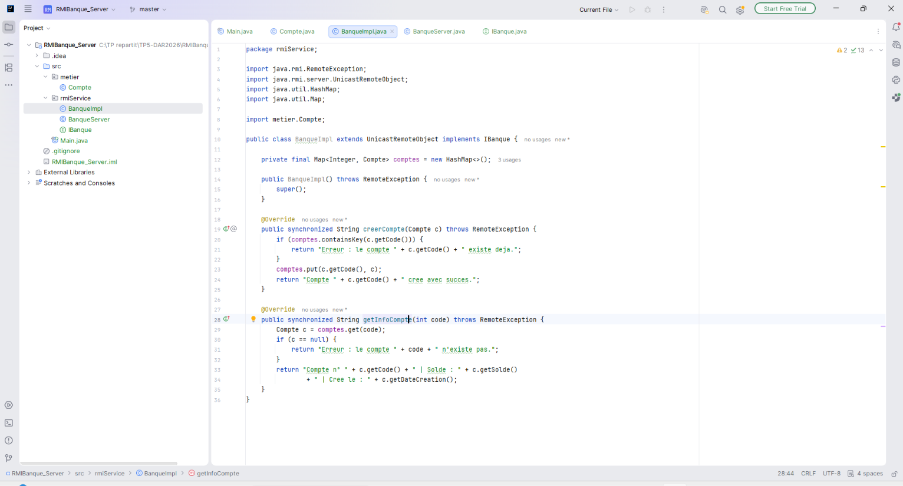

**Serveur `BanqueServer`** (package `rmiServer`)
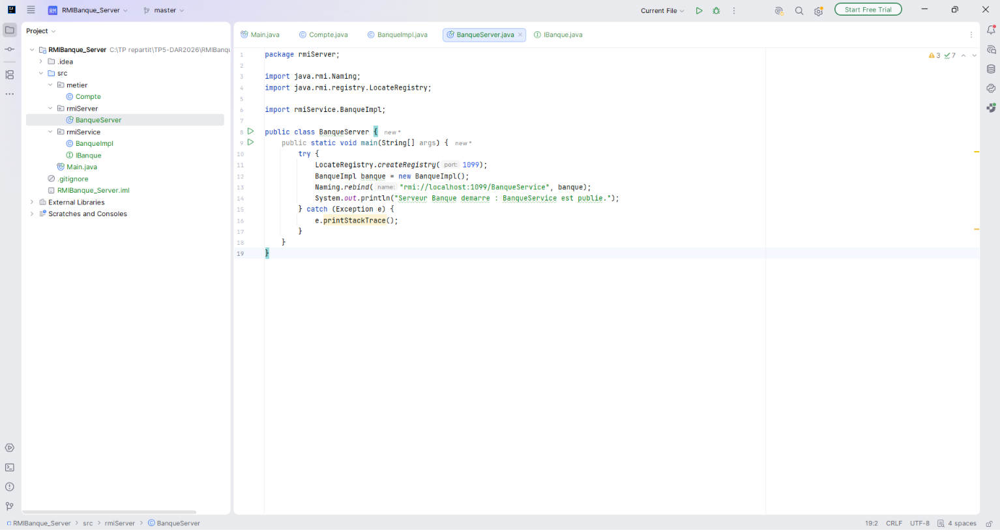
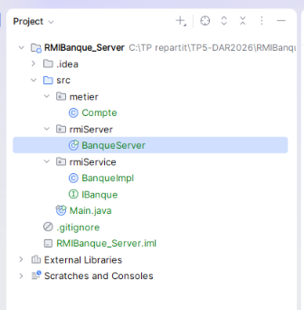

## Étape 3 : Client `RMIBanque_Client`
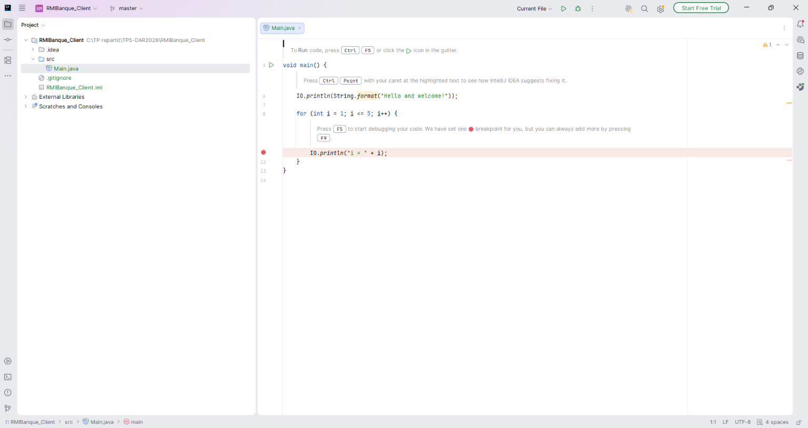

**Export de `banqueClient.jar`** (uniquement `IBanque` et `Compte`)
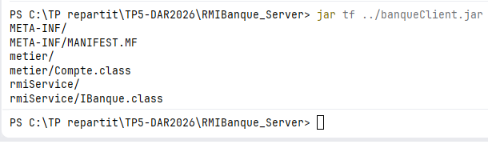
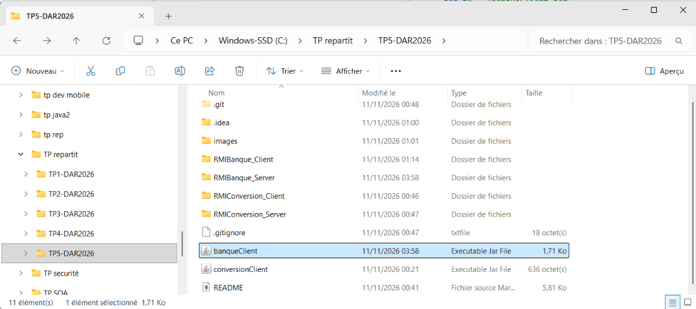

**Ajout au classpath**
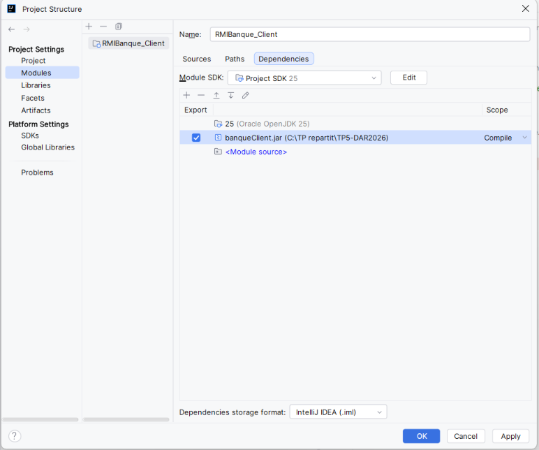
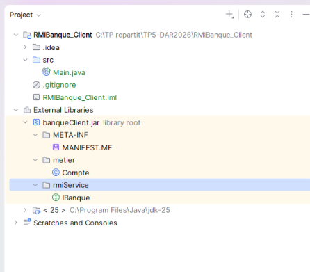

**Classe `BanqueClient`**
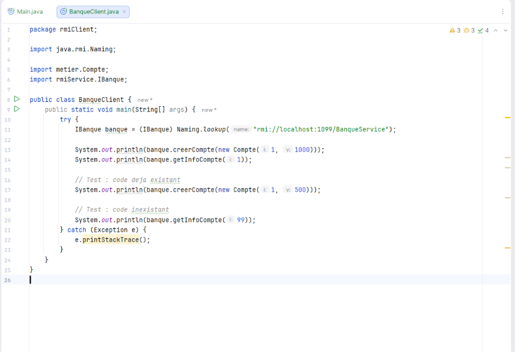

## Étape 4 : Exécution (registre RMI)
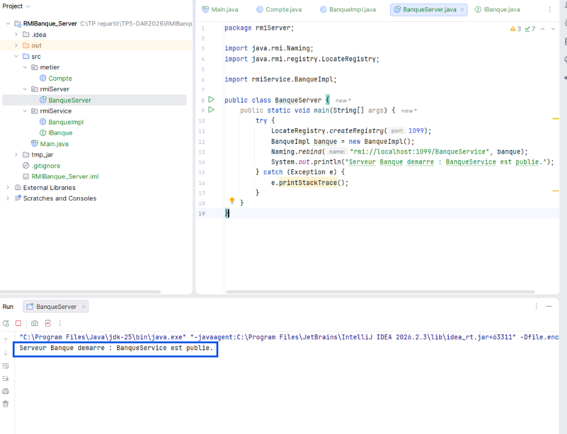
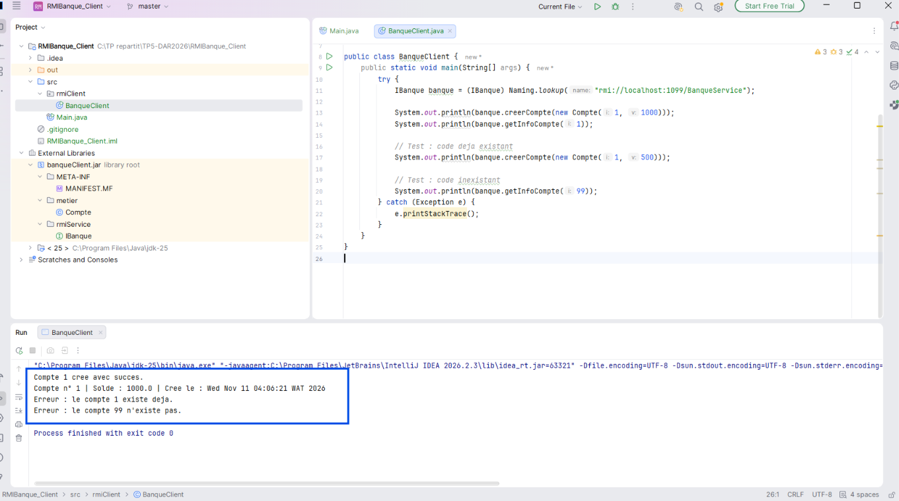

## Étape 5 : Migration vers JNDI

**Fichier `jndi.properties`** (dans `src`, côté serveur et côté client) :
```properties
java.naming.factory.initial=com.sun.jndi.rmi.registry.RegistryContextFactory
java.naming.provider.url=rmi://localhost:1099
```
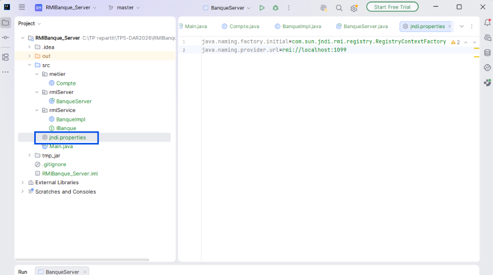

**Serveur** : le binding se fait avec `InitialContext.rebind("BanqueService", banque)`.
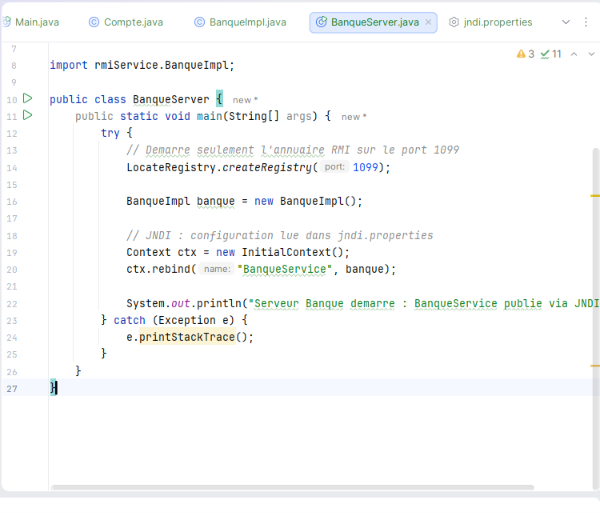

**Client** : la recherche se fait avec `InitialContext.lookup("BanqueService")`.
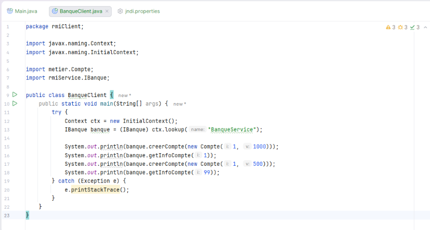

**Exécution avec JNDI**
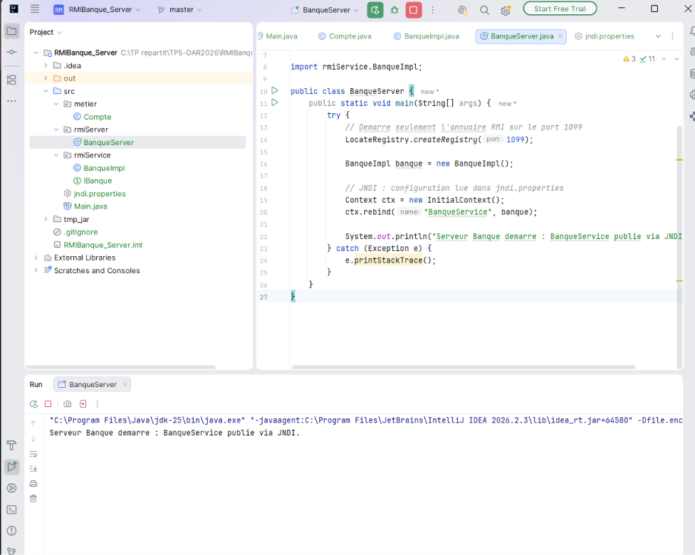
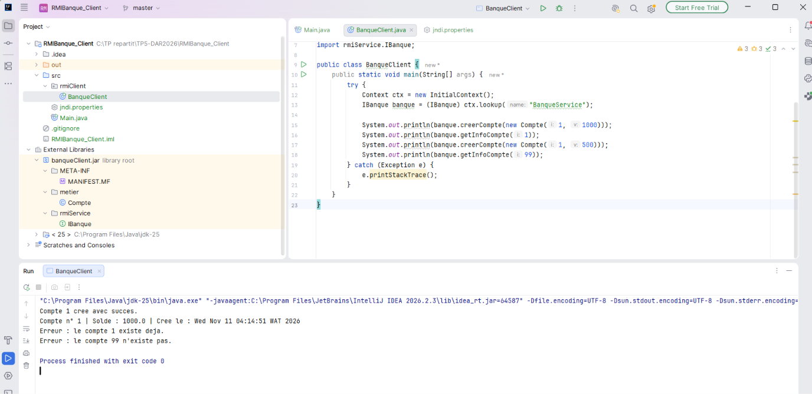

## Synthèse
Cette activité m'a permis de développer un service bancaire réparti avec Java RMI.
La classe `Compte` implémente `Serializable` : elle est passée **par valeur**
(copie) entre le client et le serveur, alors que l'objet `BanqueImpl` est
accessible **par référence** (stub). Le client ne reçoit que `IBanque` et `Compte`
via `banqueClient.jar`. Le serveur contrôle les règles métier : un code déjà
utilisé est refusé, et la consultation d'un code inexistant renvoie un message d'erreur.

Avec JNDI, le code ne dépend plus directement de `Naming`. L'accès à l'annuaire
passe par `InitialContext`, configuré par `jndi.properties` (fabrique
`RegistryContextFactory` et URL `rmi://localhost:1099`). Changer d'annuaire
revient alors à modifier ce fichier, pas le code. Le registre RMI doit toutefois
rester démarré, car JNDI s'appuie dessus.